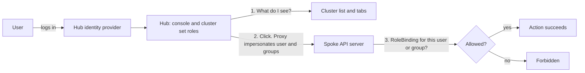

# RBAC in ACM: the patterns you need

ACM has no single RBAC switch. Access is several patterns, and each one answers a different question.

Three ideas carry the guide:

- **The default is a service account.** ACM deploys service accounts that perform actions on managed clusters. That is simple, and it has three costs: audit, flexibility, and hub access becoming spoke power.
- **People should be impersonated.** The hub decides what a user can see. The spoke decides what that same user can do. A grant on only one side leaves them stuck.
- **Not everything is GA.** `MulticlusterRoleAssignment` is GA for OpenShift Virtualization. Log and metric scoping through the same object is planned, not shipped.

Present the sections through the checklist. The appendix is reference.

## TL;DR

1. **Default actions run as a service account.** The spoke audit log names that account, not the hub user. Anyone who can drive the account from the hub gets its rights on the spoke.
2. **Two planes for people.** A hub role decides what you see. A spoke binding decides what you can do. You need both, and the group name must match.
3. **Cluster sets control visibility.** A `ManagedClusterSet` is the set of clusters a team may see and target.
4. **`MulticlusterRoleAssignment` is the central grant for people.** One object on the hub says who gets which role, on which clusters, in which namespaces.
5. **RBAC cannot say "only this field."** For a rule such as "a namespace admin may add only one label," use admission control on the cluster that owns the object.

**If you only do one thing:** stop handing people the addon and work service accounts. Use one central identity provider, bind groups on both planes, and name groups per zone or team (for example `zonea-vm-admins`).

## The default: service accounts on the spoke

By default, ACM deploys service accounts that perform actions on managed clusters. The klusterlet work agent applies what the hub sends. Addon agents (policy, observability, and others) act with their own accounts. The spoke authorizes those accounts. It does not authorize the person who clicked on the hub.

That design has three problems.

**Audit.** The spoke audit log records `system:serviceaccount:...`. It does not record which hub user caused the change. You cannot answer "who deleted this virtual machine" from the spoke log when the agent applied the change.

**Flexibility.** The service account's role is the permission for everyone who can trigger it. You cannot give one team virtual-machine admin and another team view through the same account.

**Hub access becomes spoke power.** A person who can submit work from the hub, or who can use a hub role that talks to those agents, can make a privileged spoke service account act. The accounts often hold broad rights, because they must apply whatever the hub sends. Access to the hub is then access to those rights on the spoke.

Controllers should keep their service accounts. People should not use them. The console path in the rest of this guide impersonates the logged-in user, and a binding on the spoke limits that user. The spoke audit log can name the person (`impersonatedUser`) instead of only the agent.

## How a console click is authorized



The hub role fills the list. Opening the object still fails when the spoke has no binding for the same group. The hub must be self-managed (`local-cluster`).

Direct login is the other path. The spoke identity provider authenticates the user, then the spoke bindings apply. The console path never asks the spoke directory. Because only the name string matters, `AP001` on the hub and `AP001` on the spoke share every binding that names `AP001`.

## Worked example: Zone A virtual machine admins

Goal: the people in group `zonea-vm-admins` may administer virtual machines on Zone A clusters, without being cluster-admin, and without using a spoke service account.

| Step | Where | What |
| --- | --- | --- |
| 1 | Identity provider | Put the people in group `zonea-vm-admins`. |
| 2 | Hub | Give the group cluster set `view` for Zone A, and `acm-vm-fleet:view`, so the clusters and the Virtualization tab appear. |
| 3 | Spokes | One `MulticlusterRoleAssignment` for that group, with `kubevirt.io:admin` and `acm-vm-extended:admin`, placed on the Zone A clusters. |
| 4 | Revoke | Remove a person from the group. The bindings stay. |

`fine-grained-rbac` is off by default on the `MultiClusterHub` in ACM 2.16 and 2.17. Enable it before step 3, or the `acm-vm-*` roles do not exist. The command is in the appendix.

## The patterns at a glance

A real deployment combines several of these. Patterns 1 to 5 grant access to people. Pattern 6 rolls grants out. Pattern 7 limits a change that RBAC has already allowed. None of them replace the service accounts that controllers use for their own work.

| # | Pattern | Question it answers | Where it is enforced |
| --- | --- | --- | --- |
| 1 | Cluster set RBAC | Which clusters can this team see? | Hub |
| 2 | `MulticlusterRoleAssignment` | Which group gets which role, on which clusters and namespaces? | Spoke bindings, created from the hub |
| 3 | Application RBAC | Who may define applications, and where may they deploy? | Hub namespace, `AppProject`, and the identity on the spoke |
| 4 | Virtualization RBAC | Who sees and manages virtual machines? | Hub console role plus spoke roles |
| 5 | Observability RBAC | Who may query logs and metrics? | Cluster set roles today. Assignment scope is planned. |
| 6 | ACM policies | How do bindings roll out and get removed? | Hub policy, object on the spoke |
| 7 | Admission control | Which field or label change is allowed? | Spoke, after RBAC allows the request |

## Pattern 1: Cluster set RBAC

Cluster set RBAC controls which clusters a team can see. It does not give them rights inside those clusters.

For a set named `zone-a`, ACM creates:

- `open-cluster-management:admin:zone-a` manages the set.
- `open-cluster-management:view:zone-a` shows the clusters and lets a `Placement` select them.

Bind `open-cluster-management:view:zone-a` to the group with a RoleBinding in the namespace that holds the `ManagedClusterSetBinding`. A `Placement` only selects clusters from sets bound to its namespace, which keeps a team's assignments inside its sites.

`open-cluster-management-global-set` can see every cluster. Use it for platform owners, not for a tenant.

Cluster set `view` does not grant `virtualmachines`, applications, or log queries on the spoke. A placement aimed at a cluster that lacks the target ClusterRole makes the console fail with `clusterrole ... not found`.

## Pattern 2: Centralized grants with MulticlusterRoleAssignment

`MulticlusterRoleAssignment` is the centralized grant for a person or a group. One object on the hub names the group, the ClusterRole, the `Placement`, and the namespaces. The cluster set says which clusters they can see. The assignment says what they may do there. The controller creates a `RoleBinding` or `ClusterRoleBinding` on each selected spoke, for that group, not for a shared service account.

| Consumer | Status | What happens |
| --- | --- | --- |
| OpenShift Virtualization | GA | The controller creates the binding on each selected managed cluster. |
| MultiClusterLogging | Not GA yet | The query path will inject the assignment's cluster and namespace scope into LogQL. The client cannot widen it. |
| MultiClusterMetrics | Not GA yet | The same scope will be injected into PromQL. |

Logging and metrics will not get a second RBAC API. Until they ship, only the OpenShift Virtualization path is GA.

Leave `targetNamespaces` empty for a cluster-wide `ClusterRoleBinding`. Set it to create a `RoleBinding` only in the listed namespaces. A namespace-level assignment grants nothing in `openshift-cnv` or in any project that is not listed.

The ClusterRole must already exist on the managed cluster. The `Placement` must exist first and should select only clusters in the right set. Prefer one assignment per group, with several `roleAssignments`, not one object per user. Many assignments for the same clusters merge into one `ClusterPermission` and can hit the ManifestWork size limit.

Examples are in the appendix.

## Pattern 3: RBAC for applications

Application RBAC is several patterns, not one ClusterRole. They share one property: an `ApplicationSet` can live in any namespace, not only in `openshift-gitops`.

Set up four things:

- The GitOps instance must watch those namespaces (`sourceNamespaces`).
- The group gets ordinary namespace RBAC on `Application` and `ApplicationSet` in the team namespace.
- An `AppProject` limits destination clusters and namespaces.
- Cluster set `view` is still required, so the `Placement` inside the ApplicationSet can see clusters.

Creating an ApplicationSet does not make the user an admin of the destination cluster. On the spoke, the API call is the GitOps service account, unless you also granted that group a spoke role with `MulticlusterRoleAssignment`. The GitOps account is one of the service accounts from the default model. Scope it, and do not treat "can edit the ApplicationSet" as "can do anything on the spoke."

| Pattern | How it works | Where rights are decided |
| --- | --- | --- |
| Team namespace owns the ApplicationSet | The group creates `ApplicationSet` and `Application` only in its namespace. The set uses an ACM `Placement` limited to that team's cluster set. | Namespace RBAC on the hub |
| Generated Applications stay in that namespace | The ApplicationSet writes `Application` objects into the same namespace. | RBAC on `Application` there, plus the `AppProject` |
| Hub push | The ApplicationSet runs on the hub and deploys to the spokes the `Placement` selected. | GitOps identity on the destination, plus any `MulticlusterRoleAssignment` |
| Spoke-local ApplicationSet | The ApplicationSet runs on the managed cluster. | Local RBAC on the spoke |

`open-cluster-management:subscription-admin` is the older hub role for Subscriptions that fan out from a channel. It does not replace spoke namespace rights for the workload.

## Pattern 4: RBAC for virtualization

A hub role opens the console tab. Spoke roles allow the action, as the user, not as the work service account. Enable `fine-grained-rbac` before the `acm-vm-*` roles exist.

| Who | Hub | Each managed cluster |
| --- | --- | --- |
| Viewer | `acm-vm-fleet:view` | `kubevirt.io:view` and `acm-vm-extended:view` |
| VM administrator, not cluster-admin | `acm-vm-fleet:view` | `kubevirt.io:admin` and `acm-vm-extended:admin` |
| Cross-cluster live migration | `acm-vm-fleet:admin` | On source and destination: `kubevirt.io:admin`, `acm-vm-extended:admin`, and cluster-scoped `acm-vm-cluster-migration:view` |

`acm-vm-fleet:*` opens the Virtualization tab. It does not grant `virtualmachines` on a spoke. `kubevirt.io:admin` includes `HyperConverged` in `openshift-cnv`. It is not OpenShift `cluster-admin`.

In-cluster migration panels still need `migrations.kubevirt.io:view`, `migrations.kubevirt.io:storagemigrate`, and `migrations.kubevirt.io:storagemigrate-multins` until those rules are folded into the extended roles. Confirm the name with `oc get clusterrole`. The console has shown an underscore (`storagemigrate_multins`). [ACM-47215](https://redhat.atlassian.net/browse/ACM-47215) uses a hyphen.

OpenShift Virtualization aggregates `kubevirt.io:admin` into the namespace `admin` role unless you opt out. On 4.22, `spec.roleAggregationStrategy: Manual` is that opt-out, and it is Developer Preview. Set it only after the explicit bindings exist.

Do not bind the retired names `kubevirt.io-acm-managed:*` or `kubevirt.io-acm-hub:*`.

## Pattern 5: RBAC for observability

Collectors should stay service accounts. The person querying must not borrow that identity.

Today, what someone can query follows the clusters their cluster set role lets them see. Hub role setup is in [Secure clusters](https://docs.redhat.com/en/documentation/red_hat_advanced_cluster_management_for_kubernetes/2.17/html-single/secure_clusters/index), "Enabling RBAC for Observability."

The planned direction is to scope queries with `MulticlusterRoleAssignment`. LogQL and PromQL enforcement on that assignment is not GA yet. There will not be a separate observability role API.

Logs need a tighter rule than metrics. A metric is a number. A log line can contain tokens, audit events, and virtual-machine console output. Permission to graph a virtual machine is a different decision from permission to read its console.

## Pattern 6: RBAC via ACM policies

A policy creates and removes the spoke binding from one place. It cannot split two people who share a username, and it cannot add anyone to a directory.

Enforce the `ClusterRoleBinding` for the zone group. `pruneObjectBehavior: DeleteIfCreated` removes it when you delete it from the policy. Place the policy only on clusters in that set where the ClusterRole exists. A second policy, placed only on `local-cluster`, binds the same group to the hub console role.

You can also enforce the `MulticlusterRoleAssignment` on the hub. The controller still creates the spoke bindings.

Remove one person from the hub group to revoke them. Remove the binding from the policy to revoke the zone. The full policy is in the appendix.

## Pattern 7: Admission control

RBAC says who may call an API. It cannot say "update only this label." Gatekeeper or Kyverno on the cluster that owns the object decides that, after RBAC has allowed the request.

| | Centralized grant | Admission control |
| --- | --- | --- |
| Declared | One `MulticlusterRoleAssignment` on the hub | A Gatekeeper or Kyverno policy on the cluster that owns the object |
| Decided | Spoke binding for the person. Query scope for logs and metrics later. | On that cluster, after RBAC allows the call |
| Answers | "May this group update namespaces on these clusters?" | "The only label they may add is `argocd.argoproj.io/managed-by`." |

ACM can copy the admission policy out with a `ConfigurationPolicy`. The copy is central. The decision is not.

**One label.** A namespace admin may change labels. Allow `argocd.argoproj.io/managed-by`, deny every other newly added label, skip namespaces whose name contains `openshift`, and skip usernames that start with `system:`. Template in the appendix.

**Block direct login.** Gatekeeper does not see the login page. Login ends by creating an `oauth.openshift.io` token. A template can deny those tokens for human users. Exempt `system:` and `kube:admin` unless another break-glass path exists. Apply in `dryrun` first. Existing tokens keep working until they expire. Hub impersonation does not create these tokens, so the console path keeps working. Template in the appendix.

## Identity setup

Every pattern binds a name string. Decide where the names come from before you create assignments.

| Setup | When to use it | What you get |
| --- | --- | --- |
| One identity provider on the hub and every spoke. Bind groups. | The default for people. | The same person has the same username everywhere. Remove them from the group to revoke access. |
| Hub groups and spoke bindings. No user identity provider on the spokes. | Direct spoke login is forbidden. | The console works. `oc login` does not. Keep a break-glass administrator for when the hub is down. |
| Zone-qualified groups such as `zonea-vm-admins` | Two zones, two directories. | An unqualified `AP001` binding would grant both people who share that name. |

Do not create a ServiceAccount per hub user. That repeats the default problem: the audit name is an account, and the account's role is shared power. The console already impersonates the user and their groups.

## Checklist

1. Decide which actions must stay on controller service accounts, and which actions must run as the person.
2. Pick the identity setup and agree on group names.
3. Create the `ManagedClusterSet` and bind each team's group to `open-cluster-management:view:<set>` or `admin`.
4. Enable `fine-grained-rbac` on the `MultiClusterHub` if you use virtualization roles.
5. Grant hub console roles, for example `acm-vm-fleet:view`.
6. Grant spoke permissions with one `MulticlusterRoleAssignment` per group.
7. Set up application namespaces, `AppProject` objects, and GitOps `sourceNamespaces` where teams deploy.
8. Deliver bindings with ACM policies when you need rollout and removal from Git.
9. Add admission policies, in `dryrun` first, only for rules RBAC cannot express.
10. Check the spoke audit log. A person's click should show that person, not only `system:serviceaccount`.

## Sources

- [Secure clusters, ACM 2.17](https://docs.redhat.com/en/documentation/red_hat_advanced_cluster_management_for_kubernetes/2.17/html-single/secure_clusters/index)
- [Fine-grained RBAC for virtual machines](https://docs.redhat.com/en/documentation/red_hat_advanced_cluster_management_for_kubernetes/2.17/html-single/secure_clusters/index#fine-grain-mca)

---

# Appendix

## A. Enable fine-grained RBAC

```bash
oc patch mch multiclusterhub -n open-cluster-management --type=json \
  -p='[{"op": "add", "path": "/spec/overrides/components/-", "value": {"name": "fine-grained-rbac", "enabled": true}}]'
```

If `fine-grained-rbac` is already listed, set that entry to `enabled: true`.

## B. MulticlusterRoleAssignment, cluster-wide

`targetNamespaces` is omitted, so the controller creates a `ClusterRoleBinding` on each selected cluster.

```yaml
apiVersion: rbac.open-cluster-management.io/v1beta1
kind: MulticlusterRoleAssignment
metadata:
  name: zonea-vm-admins
  namespace: site-virt
spec:
  subject:
    kind: Group
    name: zonea-vm-admins
    apiGroup: rbac.authorization.k8s.io
  roleAssignments:
    - name: kubevirt-admin
      clusterRole: kubevirt.io:admin
      clusterSelection:
        type: placements
        placements:
          - name: remote-vm-sites
            namespace: site-virt
```

## C. MulticlusterRoleAssignment, namespace level

The controller creates a `RoleBinding` in each listed namespace, and nowhere else on the spoke.

```yaml
apiVersion: rbac.open-cluster-management.io/v1beta1
kind: MulticlusterRoleAssignment
metadata:
  name: zonea-vm-namespace-admins
  namespace: site-virt
spec:
  subject:
    kind: Group
    name: zonea-vm-namespace-admins
    apiGroup: rbac.authorization.k8s.io
  roleAssignments:
    - name: kubevirt-admin
      clusterRole: kubevirt.io:admin
      targetNamespaces:
        - team-a-vms
        - team-b-vms
      clusterSelection:
        type: placements
        placements:
          - name: remote-vm-sites
            namespace: site-virt
    - name: extended-admin
      clusterRole: acm-vm-extended:admin
      targetNamespaces:
        - team-a-vms
        - team-b-vms
      clusterSelection:
        type: placements
        placements:
          - name: remote-vm-sites
            namespace: site-virt
```

## D. Policy that enforces the spoke binding

```yaml
apiVersion: policy.open-cluster-management.io/v1
kind: Policy
metadata:
  name: zonea-vm-admins
  namespace: open-cluster-management-global-set
spec:
  remediationAction: enforce
  disabled: false
  pruneObjectBehavior: DeleteIfCreated
  policy-templates:
    - objectDefinition:
        apiVersion: policy.open-cluster-management.io/v1
        kind: ConfigurationPolicy
        metadata:
          name: zonea-vm-admins-kubevirt
        spec:
          remediationAction: enforce
          severity: high
          object-templates:
            - complianceType: musthave
              objectDefinition:
                apiVersion: rbac.authorization.k8s.io/v1
                kind: ClusterRoleBinding
                metadata:
                  name: zonea-vm-admins-kubevirt
                roleRef:
                  apiGroup: rbac.authorization.k8s.io
                  kind: ClusterRole
                  name: kubevirt.io:admin
                subjects:
                  - kind: Group
                    apiGroup: rbac.authorization.k8s.io
                    name: zonea-vm-admins
---
apiVersion: cluster.open-cluster-management.io/v1beta1
kind: Placement
metadata:
  name: zonea-clusters
  namespace: open-cluster-management-global-set
spec:
  predicates:
    - requiredClusterSelector:
        labelSelector:
          matchLabels:
            zone: zonea
  tolerations:
    - key: cluster.open-cluster-management.io/unreachable
      operator: Equal
    - key: cluster.open-cluster-management.io/unavailable
      operator: Equal
---
apiVersion: policy.open-cluster-management.io/v1
kind: PlacementBinding
metadata:
  name: zonea-vm-admins
  namespace: open-cluster-management-global-set
placementRef:
  apiGroup: cluster.open-cluster-management.io
  kind: Placement
  name: zonea-clusters
subjects:
  - apiGroup: policy.open-cluster-management.io
    kind: Policy
    name: zonea-vm-admins
```

## E. Gatekeeper: one label on a namespace

```yaml
apiVersion: templates.gatekeeper.sh/v1beta1
kind: ConstraintTemplate
metadata:
  name: k8snamespacelabel
spec:
  crd:
    spec:
      names:
        kind: K8sNamespaceLabel
  targets:
    - target: admission.k8s.gatekeeper.sh
      rego: |
        package namespacelabel

        violation[{"msg": msg}] {
          input.review.operation == "UPDATE"
          input.review.kind.kind == "Namespace"
          not contains(lower(input.review.object.metadata.name), "openshift")
          not startswith(input.review.userInfo.username, "system:")
          added := { key |
            input.review.object.metadata.labels[key]
            not input.review.oldObject.metadata.labels[key]
          }
          count(added) > 0
          label := added[_]
          label != "argocd.argoproj.io/managed-by"
          msg := sprintf("Added label '%v' is not allowed on namespace '%v'. Only 'argocd.argoproj.io/managed-by' is permitted.", [label, input.review.object.metadata.name])
        }
---
apiVersion: constraints.gatekeeper.sh/v1beta1
kind: K8sNamespaceLabel
metadata:
  name: namespace-admin-one-label
spec:
  enforcementAction: dryrun
  match:
    kinds:
      - apiGroups: [""]
        kinds: ["Namespace"]
```

## F. Gatekeeper: block direct spoke login

```yaml
apiVersion: templates.gatekeeper.sh/v1beta1
kind: ConstraintTemplate
metadata:
  name: k8sblockspokelogin
spec:
  crd:
    spec:
      names:
        kind: K8sBlockSpokeLogin
      validation:
        openAPIV3Schema:
          type: object
          properties:
            exemptUsers:
              type: array
              items:
                type: string
  targets:
    - target: admission.k8s.gatekeeper.sh
      rego: |
        package k8sblockspokelogin

        violation[{"msg": msg}] {
          is_login_token
          input.review.operation == "CREATE"
          username := object.get(input.review.object, "userName", "")
          not exempt(username)
          msg := sprintf("direct spoke login is blocked for %q", [username])
        }

        violation[{"msg": msg}] {
          input.review.kind.group == "config.openshift.io"
          input.review.kind.kind == "OAuth"
          input.review.operation != "DELETE"
          incoming := count(providers(input.review.object))
          incoming > count(providers(object.get(input.review, "oldObject", {})))
          msg := "direct spoke login is blocked: do not add OAuth identityProviders"
        }

        is_login_token {
          input.review.kind.group == "oauth.openshift.io"
          input.review.kind.kind == "OAuthAccessToken"
        }

        is_login_token {
          input.review.kind.group == "oauth.openshift.io"
          input.review.kind.kind == "OAuthAuthorizeToken"
        }

        providers(obj) = result {
          result := object.get(object.get(obj, "spec", {}), "identityProviders", [])
        }

        exempt(username) {
          startswith(username, "system:")
        }

        exempt(username) {
          exempt_users[_] == username
        }

        exempt_users[username] {
          params := object.get(input, "parameters", {})
          not object.get(params, "exemptUsers", false)
          username := "kube:admin"
        }

        exempt_users[username] {
          username := input.parameters.exemptUsers[_]
        }
---
apiVersion: constraints.gatekeeper.sh/v1beta1
kind: K8sBlockSpokeLogin
metadata:
  name: block-spoke-login
spec:
  enforcementAction: dryrun
  match:
    kinds:
      - apiGroups: ["oauth.openshift.io"]
        kinds: ["OAuthAccessToken", "OAuthAuthorizeToken"]
      - apiGroups: ["config.openshift.io"]
        kinds: ["OAuth"]
  parameters:
    exemptUsers:
      - kube:admin
```
