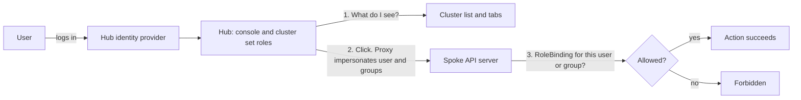

# RBAC in ACM: the patterns you need

ACM has no single RBAC switch. Access is several patterns, and each one answers a different question.

Three ideas carry the guide:

- **The default is a service account.** ACM deploys service accounts that perform actions on managed clusters. That is simple, and it has three costs: audit, flexibility, and hub access becoming spoke power.
- **People should be impersonated.** The hub decides what a user can see. The spoke decides what that same user can do. A grant on only one side leaves them stuck.
- **Not everything is GA.** `MulticlusterRoleAssignment` is GA for OpenShift Virtualization. Log and metric scoping through the same object is planned, not shipped.

Present the sections through the checklist. The appendix is reference.

## Overview

1. **Default actions run as a service account.** The spoke audit log names that account, not the hub user. Anyone who can drive the account from the hub gets its rights on the spoke.
2. **Two planes for people.** A hub role decides what you see. A spoke binding decides what you can do. You need both, and the group name must match.
3. **Cluster sets control visibility.** A `ManagedClusterSet` is the set of clusters a team may see and target.
4. **`MulticlusterRoleAssignment` is the central grant for people.** One object on the hub says who gets which role, on which clusters, in which namespaces.
5. There are edge cases. **RBAC cannot say "only this field."** For a rule such as "a namespace admin may add only one label," use admission control on the cluster that owns the object.

## The default: service accounts on the spoke

By default, ACM deploys service accounts that perform actions on managed clusters. The klusterlet work agent applies what the hub sends. Addon agents (policy, observability, and others) act with their own accounts. The spoke authorizes those accounts. It does not authorize the person who clicked on the hub.

That design has three problems.

**Audit.** The spoke audit log records `system:serviceaccount:...`. It does not record which hub user caused the change. You cannot answer "who deleted this virtual machine" from the spoke log when the agent applied the change.

**Flexibility.** The service account's role is the permission for everyone who can trigger it. You cannot give one team virtual-machine admin and another team view through the same account.

**Hub access becomes spoke power.** A person who can submit work from the hub, or who can use a hub role that talks to those agents, can make a privileged spoke service account act. The accounts often hold broad rights, because they must apply whatever the hub sends. Access to the hub is then access to those rights on the spoke.

Controllers should keep their service accounts. 

People should not use them. The console path in the rest of this guide impersonates the logged-in user, and a binding on the spoke limits that user. The spoke audit log can name the person (`impersonatedUser`) instead of only the agent.

## How a console click is authorized



The hub role fills the list. Opening the object still fails when the spoke has no binding for the same group. The hub must be self-managed (`local-cluster`).

Direct login is the other path. The spoke identity provider authenticates the user, then the spoke bindings apply. The console path never asks the spoke directory. Because only the name string matters, `AP001` on the hub and `AP001` on the spoke share every binding that names `AP001`.

## Worked example: Zone A virtual machine admins

Goal: the people in group `zonea-vm-admins` may administer virtual machines on Zone A clusters, without being cluster-admin, and without using a spoke service account.

| Step | Where | What |
| --- | --- | --- |
| 1 | Identity provider | Put the people in group `zonea-vm-admins`. |
| 2 | Hub | Give the group cluster set `view` for Zone A, and `acm-vm-fleet:view`, so the clusters and the Virtualization tab appear. |
| 3 | Spokes | One `MulticlusterRoleAssignment` for that group, with `kubevirt.io:admin` and `acm-vm-extended:admin`, placed on the Zone A clusters. |
| 4 | Revoke | Remove a person from the group. The bindings stay. |

`fine-grained-rbac` is off by default on the `MultiClusterHub` in ACM 2.16 and 2.17. Enable it before step 3, or the `acm-vm-*` roles do not exist. The command is in the appendix.

## The patterns at a glance

A real deployment combines several of these. Patterns 1, 2, 4, and 5 grant access to people. Pattern 3 often grants developers nothing on the hub: they work on the spokes, and ACM controls and monitors. Pattern 6 rolls grants out. Pattern 7 limits a change that RBAC has already allowed. None of them replace the service accounts that controllers use for their own work.

| # | Pattern | Question it answers | Where it is enforced |
| --- | --- | --- | --- |
| 1 | Cluster set RBAC | Which clusters can this team see? | Hub |
| 2 | `MulticlusterRoleAssignment` | Which group gets which role, on which clusters and namespaces? | Spoke bindings, created from the hub. A namespace list is harder to own than one cluster-wide binding. |
| 3 | Application RBAC | Where do developers change applications? | Often on the spoke only, with spoke RBAC. ACM controls and monitors. Hub login and central Argo CD are optional, and many customers do not allow them. |
| 4 | Virtualization RBAC | Who sees and manages virtual machines? | Hub console role plus spoke roles |
| 5 | Observability RBAC | Who may query logs and metrics? | Cluster set roles today. Assignment scope is planned. |
| 6 | ACM policies | How do bindings roll out and get removed? | Hub policy, object on the spoke |
| 7 | Admission control | Which field or label change is allowed? | Spoke, after RBAC allows the request |

## Pattern 1: Cluster set RBAC

Cluster set RBAC controls which clusters a team can see. It does not give them rights inside those clusters.

For a set named `zone-a`, ACM creates:

- `open-cluster-management:admin:zone-a` manages the set.
- `open-cluster-management:view:zone-a` shows the clusters and lets a `Placement` select them.

Bind `open-cluster-management:view:zone-a` to the group with a RoleBinding in the namespace that holds the `ManagedClusterSetBinding`. A `Placement` only selects clusters from sets bound to its namespace, which keeps a team's assignments inside its sites.

`open-cluster-management-global-set` can see every cluster. Use it for platform owners, not for a tenant.

Cluster set `view` does not grant `virtualmachines`, applications, or log queries on the spoke. A placement aimed at a cluster that lacks the target ClusterRole makes the console fail with `clusterrole ... not found`.

## Pattern 2: Centralized grants with MulticlusterRoleAssignment

`MulticlusterRoleAssignment` is the centralized grant for a person or a group. One object on the hub names the group, the ClusterRole, the `Placement`, and the namespaces. The cluster set says which clusters they can see. The assignment says what they may do there. The controller creates a `RoleBinding` or `ClusterRoleBinding` on each selected spoke, for that group, not for a shared service account.

| Consumer | Status | What happens |
| --- | --- | --- |
| OpenShift Virtualization | GA | The controller creates the binding on each selected managed cluster. |
| MultiClusterLogging | Not GA yet | The query path will inject the assignment's cluster and namespace scope into LogQL. The client cannot widen it. |
| MultiClusterMetrics | Not GA yet | The same scope will be injected into PromQL. |

Logging and metrics will not get a second RBAC API. Until they ship, only the OpenShift Virtualization path is GA.

Leave `targetNamespaces` empty for a cluster-wide `ClusterRoleBinding`. Set it to create a `RoleBinding` only in the listed namespaces. A namespace-level assignment grants nothing in `openshift-cnv` or in any project that is not listed.

### Namespace-level RBAC from the hub

Namespace-level RBAC is more complex when you work from a centralized place.

On the spoke, someone creates one RoleBinding in a namespace that already exists on that cluster. From the hub, `targetNamespaces` is the list of those namespaces. The controller creates a RoleBinding in each listed namespace, on each cluster the Placement selects. An empty list is the simple centralized grant: one cluster-wide ClusterRoleBinding. A filled list is the complex grant.

- A new namespace on one spoke does not update the hub object. Someone has to add the name.
- Clusters in one Placement often use different project names. The same list then misses a project on one cluster and names a project that does not exist on another.
- The grant applies only to names on the list. For virtualization, that excludes `openshift-cnv` and any project left off the list.
- A long list, repeated across clusters, merges into one `ClusterPermission` and can hit the ManifestWork size limit. Keep one assignment per group, and keep the list short. The namespace example is in the appendix.
- Centralized applications add more lists that have to match: the team namespace, the GitOps `sourceNamespaces`, the AppProject `sourceNamespaces`, and the destination namespace. Miss one and the Application is not reconciled, or it lands in the wrong place.

Spoke-local RBAC stays one binding in the namespace the developer is already using. Take on the hub list when a platform team must roll that same namespace grant out, and is ready to own the list.

The ClusterRole must already exist on the managed cluster. The `Placement` must exist first and should select only clusters in the right set. Prefer one assignment per group, with several `roleAssignments`, not one object per user. Many assignments for the same clusters merge into one `ClusterPermission` and can hit the ManifestWork size limit.

Examples are in the appendix.

## Pattern 3: RBAC for applications

Many customers do not allow centralized access. Developers do not log in to the hub, and they do not open Argo CD there. RBAC is configured on the spokes. Developers work on their own clusters. ACM controls those clusters and monitors them: policy, lifecycle, and observability. The hub is the platform console, not the application console.

| | Spoke-local, the common case | Centralized, only when the customer allows it |
| --- | --- | --- |
| Developer | Logs in to the spoke. Spoke RoleBindings decide what they can do. | Logs in to the hub, or to Argo CD on the hub. |
| Where the app changes | On that cluster, as that person. The spoke audit log names them. | A GitOps or agent service account on the destination. |
| What ACM is for | Control and monitoring, used by the platform team. | Also the place where the ApplicationSet and the Argo CD policy live. |

In the spoke-local case, grant developers no cluster set role, no hub namespace, and no Argo CD role. Put their RoleBindings on the spoke. ACM can still deliver those bindings with a policy. The binding is enforced where the developer works.

Namespace-level RBAC is the part that gets harder if you move that work to the hub. A cluster-wide role is one binding. A per-project role becomes a list of namespaces on every selected cluster, and the hub has to keep that list current. Pattern 2 spells that out.

The rest of this pattern is the centralized case. Open it only for a customer who wants developers or app-admins on the hub. ACM RBAC and Argo CD RBAC stay independent there. A cluster set role does not open Argo CD. An Argo CD role does not grant a cluster set. Answer three questions before you open either door:

1. Who may log in to the hub, and which clusters may they see?
2. Who may open Argo CD on the hub?
3. Which account performs the change on the managed cluster?

### Who may access the hub

When centralized access is allowed, a developer and an app-admin may log in to the hub. Give them their cluster set. Keep hub `cluster-admin` for the platform owners. When it is not allowed, this table does not apply: those people have no hub grant.

| Person | Hub grant | What that grant allows |
| --- | --- | --- |
| Developer | `open-cluster-management:view:zone-a`, plus create and update on `Application` and `ApplicationSet` in the team namespace | The ACM console lists Zone A. A `Placement` in that namespace can select those clusters. They can commit the ApplicationSet in their namespace. |
| App-admin | The same cluster set `view` | The same cluster list in the ACM console. Argo CD rights are a separate grant, below. They are still not hub `cluster-admin`. |
| Platform owner | `open-cluster-management-global-set`, and admin on the GitOps control-plane namespace | Every cluster, and the Argo CD installation itself. |

Cluster set `view` shows clusters. It does not create Applications, open the Argo CD UI, or grant rights on a spoke. Hub access is still powerful: a hub role that can submit work can drive the service accounts from the start of this guide. Keep the developer and the app-admin inside their set and their namespace.

### Who may open Argo CD on the hub

A developer is allowed into the Argo CD UI only when Argo CD's own policy says so.

If Argo CD trusts the same identity provider as the hub, that developer can reach the Argo CD login. After login, Argo CD ignores ACM cluster sets and ACM fine-grained RBAC. It allows the request only when `argocd-rbac-cm` (or `spec.rbac` on the OpenShift GitOps `ArgoCD` object) maps their group to a role, and the `AppProject` allows that role.

Leave `policy.default` empty. `policy.default: role:readonly` gives every authenticated Argo CD user read access to every project. Map groups explicitly:

| Person | Argo CD role | Typical policy |
| --- | --- | --- |
| Developer | No Argo CD role, unless they must use the UI | Prefer Kubernetes RBAC on the team namespace, so they edit the ApplicationSet without the UI. If they need the UI, grant `applications` `get` on `dev-project/*` only. |
| App-admin | Project role | `get` and `sync` on that project's applications. Leave `exec` and `override` off. |
| Platform owner | `role:admin` | The control plane, cluster secrets, and project definitions. |

A developer who can see Zone A in the ACM console is not thereby an Argo CD user. An app-admin who can sync `dev-project` in Argo CD is not thereby allowed to see every cluster on the hub.

Argo CD policies use this form. The full example is in the appendix.

```text
p, <role>, <resource>, <action>, <project>/<object>, <allow or deny>
g, <group>, <role>
```

Resources include `applications`, `applicationsets`, `clusters`, `repositories`, `projects`, `logs`, and `exec`. Actions include `get`, `create`, `update`, `delete`, `sync`, and `override`. Project roles and local project tokens live on the `AppProject`. System roles and the OIDC group map live in the ConfigMap.

### ApplicationSets in the team namespace

An ApplicationSet can live in any namespace you enable, not only in `openshift-gitops` or `argocd`. The team commits manifests in its own namespace. They do not need write access to the control-plane namespace.

Enable both sides. The controller must watch the namespace, and the `AppProject` must list it. An Application outside the control plane is reconciled only when its namespace is in `spec.sourceNamespaces` of the project it names. Generated Applications are created in the same namespace as the ApplicationSet. Enable Application namespaces and ApplicationSet namespaces together, or the generated Applications sit unreconciled.

On OpenShift GitOps, set `spec.sourceNamespaces` and `spec.applicationSet.sourceNamespaces` on the `ArgoCD` object. Upstream Argo CD sets `application.namespaces` and `applicationsetcontroller.namespaces` on `argocd-cmd-params-cm`. Applications in any namespace started in Argo CD 2.5. ApplicationSets in any namespace started in 2.8. Examples are in the appendix.

| Pattern | How it works | Where rights are decided |
| --- | --- | --- |
| Spoke-local, developers stay on the cluster | The common case. No hub login. RBAC and the ApplicationSet, when there is one, live on the spoke. ACM controls and monitors. | Spoke RoleBindings |
| Team namespace owns the ApplicationSet | Centralized. The group creates `ApplicationSet` and `Application` only in its namespace on the hub. The set uses an ACM `Placement` limited to that team's cluster set. | Namespace RBAC on the hub |
| Generated Applications stay in that namespace | The ApplicationSet writes `Application` objects into the same namespace. | RBAC on `Application` there, plus the `AppProject` |
| Hub push | The ApplicationSet runs on the hub and deploys to the spokes the `Placement` selected. | The GitOps or agent service account on the destination |

Keep the control-plane namespace out of a tenant `AppProject`'s `sourceNamespaces`. A tenant project that can source the control plane can take over the instance.

A cluster generator with an empty selector can see every cluster that Argo CD knows. Require a label selector, or restrict who may use the `clusters` resource in Argo CD RBAC. For pull-request and SCM generators, turn on strict token refs so a secret is usable only when it carries `argocd.argoproj.io/secret-type: scm-creds`.

`open-cluster-management:subscription-admin` is the older hub role for Subscriptions that fan out from a channel. It is a different pattern. It does not grant the Argo CD UI, and it does not replace spoke namespace rights for the workload.

### Who the spoke sees

Creating an ApplicationSet does not make the developer an admin of the destination cluster. The spoke authorizes a service account.

On a normal Argo CD install the control plane connects out to each cluster API. Argo CD 3.5 can impersonate a destination service account for UI and server operations, including logs, resource actions, and deletes, when `application.sync.impersonation.enabled` is `true`. That flag is off by default. The account comes from `AppProject.spec.destinationServiceAccounts`. The spoke audit log names that service account. It does not name the developer. This is a narrower account per project. It is still an account, which is the same class of problem as the default ACM service accounts: the audit name is the account, and the account's role is the ceiling for everyone who can trigger it.

### Argo CD agent

`argocd-agent` reverses the connection. The workload cluster dials the hub. The hub does not need a route to the spoke API. That fits NAT, firewalls, and large fleets.

| | Push | Agent |
| --- | --- | --- |
| Connection | Hub opens the spoke API | Spoke agent opens a stream to the hub |
| Spoke identity | Control-plane service account, or a `destinationServiceAccounts` account when impersonation is on | The agent service account |
| Fits | A modest number of clusters on one network | Edge and large fleets, where the hub should not store every spoke admin credential |

The agent has two modes. Managed mode runs a small agent. The hub renders manifests and streams them. Autonomous mode runs an application controller and repo server on the spoke, so that cluster keeps reconciling when the hub is unreachable, and reports status back.

The agent resource proxy does not honor `destinationServiceAccounts`. On clusters that use the agent, logs, sync, and other cluster operations run as the agent's service account. The tenant boundary is the `AppProject`: source repositories, destination clusters and namespaces, and resource allow and deny lists. Kubernetes RBAC on the spoke does not see the developer.

That is the default service-account problem again. The agent account is often broad, because it must apply what the hub asks. An app-admin who can sync an `AppProject` with a wide destination, or a developer who can point an ApplicationSet at that project, can make that account act. Scope the project. Scope the agent account. Do not treat "can open Argo CD" as "is that person on the spoke."

Support for `destinationServiceAccounts` on the agent proxy is requested, not shipped. The same is true of one RBAC model that covers the ACM console and the Argo CD UI. The items that track this are [ACM-32299](https://redhat.atlassian.net/browse/ACM-32299), RFE-9684, RFE-10027, RFE-9986, and argocd-agent issue 1152.

## Pattern 4: RBAC for virtualization

A hub role opens the console tab. Spoke roles allow the action, as the user, not as the work service account. Enable `fine-grained-rbac` before the `acm-vm-*` roles exist.

| Who | Hub | Each managed cluster |
| --- | --- | --- |
| Viewer | `acm-vm-fleet:view` | `kubevirt.io:view` and `acm-vm-extended:view` |
| VM administrator, not cluster-admin | `acm-vm-fleet:view` | `kubevirt.io:admin` and `acm-vm-extended:admin` |
| Cross-cluster live migration | `acm-vm-fleet:admin` | On source and destination: `kubevirt.io:admin`, `acm-vm-extended:admin`, and cluster-scoped `acm-vm-cluster-migration:view` |

`acm-vm-fleet:*` opens the Virtualization tab. It does not grant `virtualmachines` on a spoke. `kubevirt.io:admin` includes `HyperConverged` in `openshift-cnv`. It is not OpenShift `cluster-admin`.

In-cluster migration panels still need `migrations.kubevirt.io:view`, `migrations.kubevirt.io:storagemigrate`, and `migrations.kubevirt.io:storagemigrate-multins` until those rules are folded into the extended roles. Confirm the name with `oc get clusterrole`. The console has shown an underscore (`storagemigrate_multins`). [ACM-47215](https://redhat.atlassian.net/browse/ACM-47215) uses a hyphen.

OpenShift Virtualization aggregates `kubevirt.io:admin` into the namespace `admin` role unless you opt out. On 4.22, `spec.roleAggregationStrategy: Manual` is that opt-out, and it is Developer Preview. Set it only after the explicit bindings exist.

Do not bind the retired names `kubevirt.io-acm-managed:*` or `kubevirt.io-acm-hub:*`.

## Pattern 5: RBAC for observability

Collectors should stay service accounts. The person querying must not borrow that identity.

Today, what someone can query follows the clusters their cluster set role lets them see. Hub role setup is in [Secure clusters](https://docs.redhat.com/en/documentation/red_hat_advanced_cluster_management_for_kubernetes/2.17/html-single/secure_clusters/index), "Enabling RBAC for Observability."

The planned direction is to scope queries with `MulticlusterRoleAssignment`. LogQL and PromQL enforcement on that assignment is not GA yet. There will not be a separate observability role API.

Logs need a tighter rule than metrics. A metric is a number. A log line can contain tokens, audit events, and virtual-machine console output. Permission to graph a virtual machine is a different decision from permission to read its console.

## Pattern 6: RBAC via ACM policies

A policy creates and removes the spoke binding from one place. It cannot split two people who share a username, and it cannot add anyone to a directory.

Enforce the `ClusterRoleBinding` for the zone group. `pruneObjectBehavior: DeleteIfCreated` removes it when you delete it from the policy. Place the policy only on clusters in that set where the ClusterRole exists. A second policy, placed only on `local-cluster`, binds the same group to the hub console role.

You can also enforce the `MulticlusterRoleAssignment` on the hub. The controller still creates the spoke bindings.

Remove one person from the hub group to revoke them. Remove the binding from the policy to revoke the zone. The full policy is in the appendix.

## Pattern 7: Admission control

RBAC says who may call an API. It cannot say "update only this label." Gatekeeper or Kyverno on the cluster that owns the object decides that, after RBAC has allowed the request.

| | Centralized grant | Admission control |
| --- | --- | --- |
| Declared | One `MulticlusterRoleAssignment` on the hub | A Gatekeeper or Kyverno policy on the cluster that owns the object |
| Decided | Spoke binding for the person. Query scope for logs and metrics later. | On that cluster, after RBAC allows the call |
| Answers | "May this group update namespaces on these clusters?" | "The only label they may add is `argocd.argoproj.io/managed-by`." |

ACM can copy the admission policy out with a `ConfigurationPolicy`. The copy is central. The decision is not.

**One label.** A namespace admin may change labels. Allow `argocd.argoproj.io/managed-by`, deny every other newly added label, skip namespaces whose name contains `openshift`, and skip usernames that start with `system:`. Template in the appendix.

**Block direct login.** Gatekeeper does not see the login page. Login ends by creating an `oauth.openshift.io` token. A template can deny those tokens for human users. Exempt `system:` and `kube:admin` unless another break-glass path exists. Apply in `dryrun` first. Existing tokens keep working until they expire. Hub impersonation does not create these tokens, so the console path keeps working. Template in the appendix.

## Identity setup

Every pattern binds a name string. Decide where the names come from before you create assignments.

| Setup | When to use it | What you get |
| --- | --- | --- |
| One identity provider on the hub and every spoke. Bind groups. | The default for people. | The same person has the same username everywhere. Remove them from the group to revoke access. |
| Hub groups and spoke bindings. No user identity provider on the spokes. | Direct spoke login is forbidden. | The console works. `oc login` does not. Keep a break-glass administrator for when the hub is down. |
| Zone-qualified groups such as `zonea-vm-admins` | Two zones, two directories. | An unqualified `AP001` binding would grant both people who share that name. |

Do not create a ServiceAccount per hub user. That repeats the default problem: the audit name is an account, and the account's role is shared power. The console already impersonates the user and their groups.

## Checklist

1. Decide which actions must stay on controller service accounts, and which actions must run as the person.
2. Pick the identity setup and agree on group names.
3. Create the `ManagedClusterSet` and bind each team's group to `open-cluster-management:view:<set>` or `admin`.
4. Enable `fine-grained-rbac` on the `MultiClusterHub` if you use virtualization roles.
5. Grant hub console roles, for example `acm-vm-fleet:view`.
6. Grant spoke permissions with one `MulticlusterRoleAssignment` per group. Leave `targetNamespaces` empty for a cluster-wide role. Add a namespace list only when the hub team can keep that list current.
7. For applications, decide whether developers work only on the spokes. If they do, grant no hub login and no Argo CD role. Configure spoke RBAC, and use ACM to control and monitor. Open hub and Argo CD access only when the customer allows centralized access, and keep the control-plane namespace out of tenant `AppProject`s.
8. Deliver bindings with ACM policies when you need rollout and removal from Git.
9. Add admission policies, in `dryrun` first, only for rules RBAC cannot express.
10. Check the spoke audit log. A person's click should show that person, not only `system:serviceaccount`.

## Sources

- [Secure clusters, ACM 2.17](https://docs.redhat.com/en/documentation/red_hat_advanced_cluster_management_for_kubernetes/2.17/html-single/secure_clusters/index)
- [Fine-grained RBAC for virtual machines](https://docs.redhat.com/en/documentation/red_hat_advanced_cluster_management_for_kubernetes/2.17/html-single/secure_clusters/index#fine-grain-mca)
- [ApplicationSets outside the control plane, OpenShift GitOps](https://docs.redhat.com/en/documentation/red_hat_openshift_gitops/1.21/html/argo_cd_application_sets/managing-app-sets-in-non-control-plane-namespaces)
- [Application sync using impersonation](https://argo-cd.readthedocs.io/en/stable/operator-manual/app-sync-using-impersonation/)

---

# Appendix

## A. Enable fine-grained RBAC

```bash
oc patch mch multiclusterhub -n open-cluster-management --type=json \
  -p='[{"op": "add", "path": "/spec/overrides/components/-", "value": {"name": "fine-grained-rbac", "enabled": true}}]'
```

If `fine-grained-rbac` is already listed, set that entry to `enabled: true`.

## B. MulticlusterRoleAssignment, cluster-wide

`targetNamespaces` is omitted, so the controller creates a `ClusterRoleBinding` on each selected cluster.

```yaml
apiVersion: rbac.open-cluster-management.io/v1beta1
kind: MulticlusterRoleAssignment
metadata:
  name: zonea-vm-admins
  namespace: site-virt
spec:
  subject:
    kind: Group
    name: zonea-vm-admins
    apiGroup: rbac.authorization.k8s.io
  roleAssignments:
    - name: kubevirt-admin
      clusterRole: kubevirt.io:admin
      clusterSelection:
        type: placements
        placements:
          - name: remote-vm-sites
            namespace: site-virt
```

## C. MulticlusterRoleAssignment, namespace level

The controller creates a `RoleBinding` in each listed namespace, and nowhere else on the spoke.

```yaml
apiVersion: rbac.open-cluster-management.io/v1beta1
kind: MulticlusterRoleAssignment
metadata:
  name: zonea-vm-namespace-admins
  namespace: site-virt
spec:
  subject:
    kind: Group
    name: zonea-vm-namespace-admins
    apiGroup: rbac.authorization.k8s.io
  roleAssignments:
    - name: kubevirt-admin
      clusterRole: kubevirt.io:admin
      targetNamespaces:
        - team-a-vms
        - team-b-vms
      clusterSelection:
        type: placements
        placements:
          - name: remote-vm-sites
            namespace: site-virt
    - name: extended-admin
      clusterRole: acm-vm-extended:admin
      targetNamespaces:
        - team-a-vms
        - team-b-vms
      clusterSelection:
        type: placements
        placements:
          - name: remote-vm-sites
            namespace: site-virt
```

## D. Policy that enforces the spoke binding

```yaml
apiVersion: policy.open-cluster-management.io/v1
kind: Policy
metadata:
  name: zonea-vm-admins
  namespace: open-cluster-management-global-set
spec:
  remediationAction: enforce
  disabled: false
  pruneObjectBehavior: DeleteIfCreated
  policy-templates:
    - objectDefinition:
        apiVersion: policy.open-cluster-management.io/v1
        kind: ConfigurationPolicy
        metadata:
          name: zonea-vm-admins-kubevirt
        spec:
          remediationAction: enforce
          severity: high
          object-templates:
            - complianceType: musthave
              objectDefinition:
                apiVersion: rbac.authorization.k8s.io/v1
                kind: ClusterRoleBinding
                metadata:
                  name: zonea-vm-admins-kubevirt
                roleRef:
                  apiGroup: rbac.authorization.k8s.io
                  kind: ClusterRole
                  name: kubevirt.io:admin
                subjects:
                  - kind: Group
                    apiGroup: rbac.authorization.k8s.io
                    name: zonea-vm-admins
---
apiVersion: cluster.open-cluster-management.io/v1beta1
kind: Placement
metadata:
  name: zonea-clusters
  namespace: open-cluster-management-global-set
spec:
  predicates:
    - requiredClusterSelector:
        labelSelector:
          matchLabels:
            zone: zonea
  tolerations:
    - key: cluster.open-cluster-management.io/unreachable
      operator: Equal
    - key: cluster.open-cluster-management.io/unavailable
      operator: Equal
---
apiVersion: policy.open-cluster-management.io/v1
kind: PlacementBinding
metadata:
  name: zonea-vm-admins
  namespace: open-cluster-management-global-set
placementRef:
  apiGroup: cluster.open-cluster-management.io
  kind: Placement
  name: zonea-clusters
subjects:
  - apiGroup: policy.open-cluster-management.io
    kind: Policy
    name: zonea-vm-admins
```

## E. Gatekeeper: one label on a namespace

```yaml
apiVersion: templates.gatekeeper.sh/v1beta1
kind: ConstraintTemplate
metadata:
  name: k8snamespacelabel
spec:
  crd:
    spec:
      names:
        kind: K8sNamespaceLabel
  targets:
    - target: admission.k8s.gatekeeper.sh
      rego: |
        package namespacelabel

        violation[{"msg": msg}] {
          input.review.operation == "UPDATE"
          input.review.kind.kind == "Namespace"
          not contains(lower(input.review.object.metadata.name), "openshift")
          not startswith(input.review.userInfo.username, "system:")
          added := { key |
            input.review.object.metadata.labels[key]
            not input.review.oldObject.metadata.labels[key]
          }
          count(added) > 0
          label := added[_]
          label != "argocd.argoproj.io/managed-by"
          msg := sprintf("Added label '%v' is not allowed on namespace '%v'. Only 'argocd.argoproj.io/managed-by' is permitted.", [label, input.review.object.metadata.name])
        }
---
apiVersion: constraints.gatekeeper.sh/v1beta1
kind: K8sNamespaceLabel
metadata:
  name: namespace-admin-one-label
spec:
  enforcementAction: dryrun
  match:
    kinds:
      - apiGroups: [""]
        kinds: ["Namespace"]
```

## F. Gatekeeper: block direct spoke login

```yaml
apiVersion: templates.gatekeeper.sh/v1beta1
kind: ConstraintTemplate
metadata:
  name: k8sblockspokelogin
spec:
  crd:
    spec:
      names:
        kind: K8sBlockSpokeLogin
      validation:
        openAPIV3Schema:
          type: object
          properties:
            exemptUsers:
              type: array
              items:
                type: string
  targets:
    - target: admission.k8s.gatekeeper.sh
      rego: |
        package k8sblockspokelogin

        violation[{"msg": msg}] {
          is_login_token
          input.review.operation == "CREATE"
          username := object.get(input.review.object, "userName", "")
          not exempt(username)
          msg := sprintf("direct spoke login is blocked for %q", [username])
        }

        violation[{"msg": msg}] {
          input.review.kind.group == "config.openshift.io"
          input.review.kind.kind == "OAuth"
          input.review.operation != "DELETE"
          incoming := count(providers(input.review.object))
          incoming > count(providers(object.get(input.review, "oldObject", {})))
          msg := "direct spoke login is blocked: do not add OAuth identityProviders"
        }

        is_login_token {
          input.review.kind.group == "oauth.openshift.io"
          input.review.kind.kind == "OAuthAccessToken"
        }

        is_login_token {
          input.review.kind.group == "oauth.openshift.io"
          input.review.kind.kind == "OAuthAuthorizeToken"
        }

        providers(obj) = result {
          result := object.get(object.get(obj, "spec", {}), "identityProviders", [])
        }

        exempt(username) {
          startswith(username, "system:")
        }

        exempt(username) {
          exempt_users[_] == username
        }

        exempt_users[username] {
          params := object.get(input, "parameters", {})
          not object.get(params, "exemptUsers", false)
          username := "kube:admin"
        }

        exempt_users[username] {
          username := input.parameters.exemptUsers[_]
        }
---
apiVersion: constraints.gatekeeper.sh/v1beta1
kind: K8sBlockSpokeLogin
metadata:
  name: block-spoke-login
spec:
  enforcementAction: dryrun
  match:
    kinds:
      - apiGroups: ["oauth.openshift.io"]
        kinds: ["OAuthAccessToken", "OAuthAuthorizeToken"]
      - apiGroups: ["config.openshift.io"]
        kinds: ["OAuth"]
  parameters:
    exemptUsers:
      - kube:admin
```

## G. Argo CD for a team namespace

OpenShift GitOps. List the team namespace for Applications and for ApplicationSets. Keep the `AppProject` in the control-plane namespace. Confirm glob and regex support on the GitOps version you run before you depend on a pattern such as `team-*`.

```yaml
apiVersion: argoproj.io/v1beta1
kind: ArgoCD
metadata:
  name: openshift-gitops
  namespace: openshift-gitops
spec:
  sourceNamespaces:
    - team-a
  applicationSet:
    sourceNamespaces:
      - team-a
```

The project allows Applications that live in `team-a`, and deploys only into the listed destinations. It does not list `openshift-gitops` under `sourceNamespaces`.

```yaml
apiVersion: argoproj.io/v1alpha1
kind: AppProject
metadata:
  name: dev-project
  namespace: openshift-gitops
spec:
  sourceNamespaces:
    - team-a
  sourceRepos:
    - https://github.com/my-org/team-a-apps
  destinations:
    - name: zone-a-cluster-1
      namespace: team-a-workloads
```

Argo CD RBAC. The default role is empty. The developer group can read applications in `dev-project`. The app-admin group can read and sync them. Neither role gets `exec`.

```yaml
apiVersion: v1
kind: ConfigMap
metadata:
  name: argocd-rbac-cm
  namespace: openshift-gitops
data:
  policy.default: ""
  policy.csv: |
    p, role:developer, applications, get, dev-project/*, allow
    p, role:app-admin, applications, get, dev-project/*, allow
    p, role:app-admin, applications, sync, dev-project/*, allow
    g, engineering:developers, role:developer
    g, engineering:app-admins, role:app-admin
```

On an upstream install the same namespace lists go on `argocd-cmd-params-cm` as `application.namespaces` and `applicationsetcontroller.namespaces`. Set `applicationsetcontroller.enable.tokenref.strict.mode` to `"true"` when pull-request or SCM generators reference secrets.

Impersonation of a destination service account is off until you set `application.sync.impersonation.enabled` to `"true"` in `argocd-cm`. Then name the account on the project:

```yaml
spec:
  destinationServiceAccounts:
    - server: https://zone-a-cluster.example.com:6443
      namespace: team-a-workloads
      defaultServiceAccount: team-a-deployer
```

The agent resource proxy does not use this list. Clusters that run `argocd-agent` still apply changes as the agent service account.
