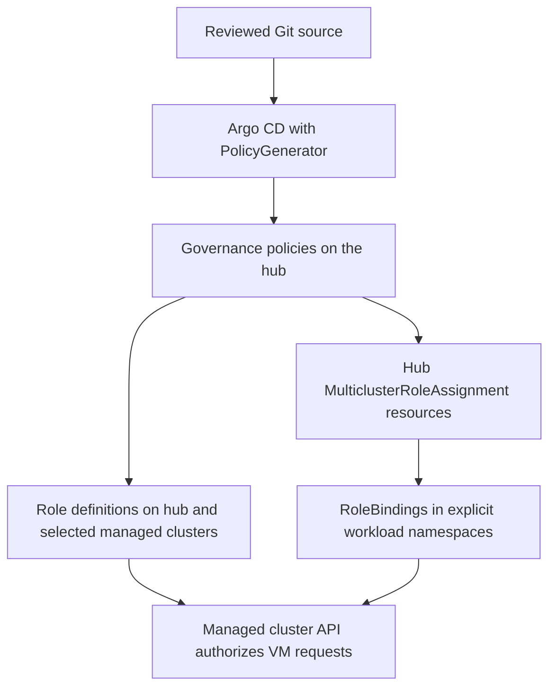

# Govern VM access with ACM 5.0

A **VM maintainer** needs to change a machine's configuration. A **lifecycle operator** needs to restart it. A **viewer** needs to inspect its state. Assigning the same broad virtualization role to all three gives people permissions their work does not require.

Across several clusters, the problem is also consistency: which group can perform which operation, in which namespace, on which clusters? Keeping those decisions in Git makes them reviewable. Red Hat Advanced Cluster Management for Kubernetes (ACM) can distribute the role definitions and create the corresponding access assignments.

This article presents an **ACM 5.0 reference design** for platform engineers. The [companion example](https://github.com/ch-stark/finegrainedrbacvirt/blob/acm5-rbac-reference-v3/vm-rbac-example/README.md) includes local checks and a [limited live hub-only validation record](https://github.com/ch-stark/finegrainedrbacvirt/blob/acm5-rbac-reference-v3/validation/hub-only/results.md). The live run used an ACM 5.1 build; full multi-cluster ACM 5.0, browser-console, and running-guest validation remain outstanding.

## Choose three access tiers

Start with the operator-provided `kubevirt.io:view` role and add only the operations each team needs. The built-in `kubevirt.io:edit` role is broader: it includes VM deletion and console/VNC access, which these tiers deliberately omit. Inspect the installed built-in roles when assessing the effective permissions. [Virtualization role definitions](https://github.com/kubevirt/kubevirt/blob/main/pkg/virt-operator/resource/generate/rbac/cluster.go)

| Access tier | Example group | Managed-cluster namespace | Additional role | Intended operations |
| --- | --- | --- | --- | --- |
| Maintainer | `tenant-a-operators` | `tenant-a-namespace` | `custom-vm-maintainer` | Create, update and patch VM objects; start, stop and restart |
| Lifecycle operator | `tenant-b-operators` | `tenant-b-namespace` | `custom-vm-lifecycle` | Start, stop and restart existing VMs |
| Viewer | `tenant-c-viewers` | `tenant-c-namespace` | None | Read virtualization resources |

Every group also receives `kubevirt.io:view` in its assigned namespace. The file names use “tenant” to identify three example teams. The **tier** describes their permissions; network, storage, resource quotas, and admission controls are separate parts of a tenant boundary.

Kubernetes RBAC is additive. Other user or group bindings can expand these permissions, and the absence of `delete` does not make VM modification harmless. Workload creation and editing can provide indirect access to namespace data. [Kubernetes RBAC considerations](https://kubernetes.io/docs/reference/access-authn-authz/rbac/)

Treat maintainers as trusted workload authors. Subject to the installed virtualization and admission configuration, VM specifications can reference namespace PVCs, Secrets and ConfigMaps, supply cloud-init content, and request devices. Review permitted references and device use before granting this tier. Where supported, admission rules such as a [ValidatingAdmissionPolicy](https://kubernetes.io/docs/reference/access-authn-authz/validating-admission-policy/) can constrain selected VM fields; this example does not install those guardrails.

VM object creation also does not supply every permission needed by a provisioning wizard, disk import, or network attachment workflow. Begin with pre-provisioned resources and test the exact workflow you intend to offer.

## Separate role delivery from access assignment

The design uses governance policies for role definitions and `MulticlusterRoleAssignment` (MRA) resources for access grants:



A hub role is available for discovery; a role binding is what grants access. The hub console grant is separate again: each group receives `acm-vm-fleet:view` on the hub, while its workload roles are bound in managed-cluster namespaces. The documented purpose of the fleet role is access to the virtualization console. It is **not a promise that all fleet metadata is hidden from other teams**. [ACM 5.0 role descriptions](https://docs.redhat.com/en/documentation/red_hat_advanced_cluster_management_for_kubernetes/5.0/html/secure_clusters/securing-cluster-intro#fine-grain-roles-descriptions)

The hub is excluded from workload placement. Even though the prerequisites include OpenShift Virtualization on the hub, these assignments give the example teams no access to hub-hosted VMs.

The repository also contains a separate [full-admin example](https://github.com/ch-stark/finegrainedrbacvirt/blob/acm5-rbac-reference-v3/examplefulladmin/README.md). Its wildcard role and cluster-wide assignment grant cluster-admin-equivalent access. Use the namespace-scoped companion files for the tiers described here.

## Prepare the hub and selected clusters

Use a supported product combination from the [ACM 5.0 support matrix](https://access.redhat.com/articles/7149098). Before proceeding, confirm:

- Governance and fine-grained virtualization RBAC are configured on the ACM 5.0 hub.
- The self-managed hub retains the name `local-cluster`, which this example's placements select explicitly.
- Supported OpenShift Virtualization installations and required built-in roles exist on the hub and intended managed clusters.
- Users, groups, and memberships match across hub and managed clusters.
- The `default` managed cluster set contains the hub and intended targets; otherwise adapt the set and binding together.
- Red Hat OpenShift GitOps is installed on the hub, and the setup administrator can configure it and impersonate test identities.

The ACM 5.0 setup procedure enables the component named `fine-grained-rbac`. Its entry in the existing `MultiClusterHub` component list is:

```yaml
spec:
  overrides:
    components:
      - name: fine-grained-rbac
        enabled: true
```

Merge this fragment into the existing `MultiClusterHub` component list. Preserve unrelated entries and avoid duplicates. The [ACM 5.0 setup procedure](https://docs.redhat.com/en/documentation/red_hat_advanced_cluster_management_for_kubernetes/5.0/html/secure_clusters/securing-cluster-intro#fine-grain-enable) documents the component and identity prerequisites.

## Define each role once

The [lifecycle role](https://github.com/ch-stark/finegrainedrbacvirt/blob/acm5-rbac-reference-v3/vm-rbac-example/roles/custom-vm-lifecycle.yaml) contains only the additional operations:

```yaml
apiVersion: rbac.authorization.k8s.io/v1
kind: ClusterRole
metadata:
  name: custom-vm-lifecycle
  labels:
    rbac.open-cluster-management.io/filter: vm-clusterroles
    clusterview.open-cluster-management.io/discoverable: 'true'
    rbac.open-cluster-management.io/custom-role: 'true'
rules:
- apiGroups:
  - subresources.kubevirt.io
  resources:
  - virtualmachines/start
  - virtualmachines/stop
  - virtualmachines/restart
  verbs:
  - update
```

The [maintainer role](https://github.com/ch-stark/finegrainedrbacvirt/blob/acm5-rbac-reference-v3/vm-rbac-example/roles/custom-vm-maintainer.yaml) adds `create`, `update`, and `patch` on `kubevirt.io` virtual machines. Read permissions come from the baseline view role. Its complete rule list is:

```yaml
rules:
- apiGroups: ["kubevirt.io"]
  resources: ["virtualmachines"]
  verbs: ["create", "update", "patch"]
- apiGroups: ["subresources.kubevirt.io"]
  resources: ["virtualmachines/start", "virtualmachines/stop", "virtualmachines/restart"]
  verbs: ["update"]
```

The three labels follow the [documented custom-role workflow](https://docs.redhat.com/en/documentation/red_hat_advanced_cluster_management_for_kubernetes/5.0/html/secure_clusters/securing-cluster-intro#fine-grain-mca-custom). A label alone does not install a propagation policy: the discovery-based approach in the documentation requires creating that policy. This design instead names its source files explicitly. `vm-rbac-hub-roles` manages hub definitions and `vm-rbac-spoke-baseline` manages managed-cluster definitions. Both read the same `roles/` directory. Do not deploy an additional discovery-based policy for these same objects.

The [generator configuration](https://github.com/ch-stark/finegrainedrbacvirt/blob/acm5-rbac-reference-v3/vm-rbac-example/policy-generator.yaml) separates role delivery from access grants. This excerpt shows its structure, with only Team A's grant files displayed:

```yaml
policies:
- name: vm-rbac-hub-roles
  placement: {placementName: vm-rbac-hub}
  manifests: [{path: roles}]
- name: vm-rbac-spoke-baseline
  placement: {placementName: vm-rbac-spokes}
  manifests:
  - {path: roles}
  - {path: namespaces, complianceType: musthave}
- name: vm-rbac-hub-assignments
  disabled: true
  placement: {placementName: vm-rbac-hub}
  manifests:
  - {path: assignments/tenant-a.yaml}
  - {path: fleet-access/tenant-a.yaml}
```

The full file includes the grant files for Teams B and C and supplies these defaults:

- `mustonlyhave` treats extra rules in these role definitions as drift and remediates them. Additional metadata is permitted; namespace objects use `musthave`.
- Hub and spoke policies have separate placements. The PolicySet groups policies without introducing another placement binding.
- The assignment policy starts disabled, allowing role and namespace checks before access is granted.
- `pruneObjectBehavior: None` retains objects when policies are removed. Revocation therefore requires an explicit transition.

## Make namespace scope visible in the assignment

MRAs live in the hub's `policies` management namespace in this example. Their workload scope comes from `targetNamespaces`, and their cluster scope comes from referenced placements. ACM 5.0's [MRA examples](https://docs.redhat.com/en/documentation/red_hat_advanced_cluster_management_for_kubernetes/5.0/html/secure_clusters/securing-cluster-intro#fine-grain-mca-examples) place the namespace-scoped example in `dev-virt` and the cluster-wide example in `prod-virt`. The management namespace name is therefore not itself the workload-access boundary.

The [lifecycle assignment](https://github.com/ch-stark/finegrainedrbacvirt/blob/acm5-rbac-reference-v3/vm-rbac-example/assignments/tenant-b.yaml) grants the baseline and additional role separately:

```yaml
apiVersion: rbac.open-cluster-management.io/v1beta1
kind: MulticlusterRoleAssignment
metadata:
  name: tenant-b-vm-access
  namespace: policies
spec:
  subject:
    kind: Group
    name: tenant-b-operators
  roleAssignments:
  - name: tenant-b-role-1
    clusterRole: kubevirt.io:view
    targetNamespaces:
    - tenant-b-namespace
    clusterSelection:
      type: placements
      placements:
      - name: vm-rbac-spokes
        namespace: policies
  - name: tenant-b-role-2
    clusterRole: custom-vm-lifecycle
    targetNamespaces:
    - tenant-b-namespace
    clusterSelection:
      type: placements
      placements:
      - name: vm-rbac-spokes
        namespace: policies
```

**Keep `targetNamespaces` populated.** An omitted or empty value creates a cluster-wide binding instead of namespace-scoped RoleBindings. [ACM binding scope](https://docs.redhat.com/en/documentation/red_hat_advanced_cluster_management_for_kubernetes/5.0/html/secure_clusters/securing-cluster-intro#fine-grain-mca-binding)

The companion baseline creates the example namespaces. A tenant group receives no namespace-creation privilege, and these workload RoleBindings do not grant cluster-scoped namespace discovery.

## Follow one rollout path

The article and its companion links use the published tag `acm5-rbac-reference-v3`, not a moving branch. Published snapshot tags are retained at their original revisions; further article changes receive a new tag. Check out this tag so the prose, manifests, and instructions stay aligned:

```bash
git clone --branch acm5-rbac-reference-v3 --single-branch \
  https://github.com/ch-stark/finegrainedrbacvirt.git
cd finegrainedrbacvirt/vm-rbac-example
git switch -c vm-rbac-deployment
```

Use your own branch or fork for configuration changes. Replace `HUB` and `SPOKE` below with kubeconfig context names.

**1. Select clusters deliberately.** Apply the [bootstrap manifest](https://github.com/ch-stark/finegrainedrbacvirt/blob/acm5-rbac-reference-v3/vm-rbac-example/bootstrap.yaml) and opt in a managed cluster:

```bash
oc --context HUB apply -f bootstrap.yaml
oc --context HUB label managedcluster managed-cluster-01 \
  example.com/vm-rbac=enabled
oc --context HUB get placementdecision -n policies -o yaml
```

Confirm that `vm-rbac-hub` selects only `local-cluster` and `vm-rbac-spokes` selects exactly the intended managed clusters. `example.com/vm-rbac` is a valid illustrative label; substitute your organization-owned prefix consistently in the label and selector if appropriate. Restrict who can edit placements and selection labels because those changes affect access.

**2. Configure PolicyGenerator in Argo CD.** The supported [ACM 5.0 GitOps integration](https://docs.redhat.com/en/documentation/red_hat_advanced_cluster_management_for_kubernetes/5.0/html-single/gitops) patches the operator-managed ArgoCD resource. Its repository-server init container installs the generator, its shared volume supplies the plugin, and `kustomizeBuildOptions` permits it to run.

Follow the [direct configuration procedure](https://github.com/ch-stark/finegrainedrbacvirt/blob/acm5-rbac-reference-v3/vm-rbac-example/README.md#configure-policygenerator-in-argo-cd). It contains the full patch and controller RBAC. Merge existing repository settings into the patch before applying it, because JSON merge patches replace arrays.

This example deliberately grants the application controller a Role in `policies`, rather than the broader ClusterRoleBinding shown in the documentation. It manages only policy resources there; the administrator creates placements separately. The [governance-policy alternative](https://github.com/ch-stark/finegrainedrbacvirt/blob/acm5-rbac-reference-v3/vm-rbac-example/README.md#configure-the-integration-with-a-governance-policy) and the linked community policy are available in the companion guide.

**3. Review and sync the baseline.** Configure the [Application](https://github.com/ch-stark/finegrainedrbacvirt/blob/acm5-rbac-reference-v3/vm-rbac-example/application.yaml) and [AppProject](https://github.com/ch-stark/finegrainedrbacvirt/blob/acm5-rbac-reference-v3/vm-rbac-example/appproject.yaml) for your repository. Set `targetRevision` to a reviewed commit SHA. The Application points at `vm-rbac-example`, so Argo CD runs the source Kustomization and PolicyGenerator.

Create the project and Application, then manually sync with `vm-rbac-hub-assignments` still disabled. Check the per-cluster policy status and inspect every intended managed cluster for both custom roles, `kubevirt.io:view`, and the three namespaces. A successful Argo CD sync does not establish downstream compliance.

**4. Grant access after the baseline is ready.** Change the assignment policy to `disabled: false`, review and commit the change, update the Application revision, and manually sync again. Check MRA status and inspect the resulting RoleBinding subjects, role references, and namespaces. The [complete rollout commands](https://github.com/ch-stark/finegrainedrbacvirt/blob/acm5-rbac-reference-v3/vm-rbac-example/README.md#deploy-the-source-through-argo-cd) remain with the manifests.

## Verify capabilities and boundaries

Run the [authorization script](https://github.com/ch-stark/finegrainedrbacvirt/blob/acm5-rbac-reference-v3/vm-rbac-example/verify-access.py) against each selected managed cluster:

```bash
python3 verify-access.py SPOKE
```

It sends explicit SelfSubjectAccessReview attributes for all three tiers, including cross-namespace denials, avoiding ambiguous client discovery of lifecycle subresources. It does not perform VM operations or test the console. Test with actual users as well: an administrator's own access and a synthetic identity's limited group list are not substitutes for real group membership.

| Acceptance check | Maintainer | Lifecycle operator | Viewer |
| --- | --- | --- | --- |
| Read VMs in the assigned namespace | Allowed | Allowed | Allowed |
| Start, stop and restart existing VMs | Allowed | Allowed | Denied |
| Create or modify VM objects with approved resources | Allowed | Denied | Denied |
| Delete VMs or use console/VNC endpoints | Denied | Denied | Denied |
| Read another team's VMs through its managed-cluster API | Denied | Denied | Denied |

For every tier, hub inventory, search, and direct details links must not expose unauthorized VM data. Exercise real operations on disposable workloads and check responses, not only whether buttons appear. Storage, admission, and networking can still reject an operation that RBAC permits.

Check console visibility with actual users:

1. Sign in as the lifecycle operator and confirm access to the assigned team's VMs.
2. Search for a known maintainer-team VM by name and namespace; try inventory filters and a saved direct details link. Confirm that unauthorized VM data remains inaccessible.
3. Repeat across all three teams, including both directions between teams.
4. Record visible cluster names, namespace names, and counts. Compare them with your organization's approved metadata-visibility requirements.

Namespace-scoped workload bindings alone do not guarantee that all fleet metadata is confidential. If the shared console exceeds your allowed metadata scope, add controls or choose a different access path before accepting the design.

Use the [validation record](https://github.com/ch-stark/finegrainedrbacvirt/blob/acm5-rbac-reference-v3/vm-rbac-example/validation-results.md) to capture product versions, the source commit, MRA status, resulting RoleBindings, console/search observations, and revocation results.

## What the live hub-only run established

On 18 November 2026, an authorized single-cluster test ran on ACM `5.1.0-184`, OpenShift `5.0.1`, OpenShift Virtualization `5.0.0`, and OpenShift GitOps `1.22.3`. Its overlay selected `local-cluster` for workloads and disabled the duplicate hub-role policy.

| Observed check | Result |
| --- | --- |
| Argo CD and the PolicyGenerator init container | Source synchronized; ACM 5.0 plugin image completed successfully |
| MRAs in `policies` | Three ready resources; five role assignments active |
| Explicit authorization queries | 57/57 passed in hub-only mode |
| Actual VM API requests | 18/18 passed, including intended denials and HTTP 202 start/stop acceptance |
| Drift, revocation, and restoration | Test rule removed; Tenant B grants revoked and restored |

The installed hub fleet role permitted namespace listing, so the checker uses `--hub-only` for this overlay. The VMI reached `Scheduling` but could not run because KVM capacity was unavailable. Browser/search checks, real identity-provider membership, and remote-cluster propagation were outside this run. The [live report and evidence](https://github.com/ch-stark/finegrainedrbacvirt/blob/acm5-rbac-reference-v3/validation/hub-only/results.md) preserve the initial webhook-readiness failure as well as the successful retry and cleanup.

## Keep the boundary after rollout

Grant changes, onboarding, revocation, and placement changes all need the same review discipline. With object retention configured, deleting a Git file or disabling a policy is insufficient proof that access disappeared.

The [revocation procedure](https://github.com/ch-stark/finegrainedrbacvirt/blob/acm5-rbac-reference-v3/vm-rbac-example/README.md#onboard-and-revoke-access) uses a temporary `mustnothave` transition, then checks hub and managed-cluster cleanup before files are removed. The companion guide also contains [troubleshooting](https://github.com/ch-stark/finegrainedrbacvirt/blob/acm5-rbac-reference-v3/vm-rbac-example/README.md#troubleshoot-the-layer-that-failed).

Start with one managed cluster and disposable VMs. Confirm the selected destinations, prove the permission and visibility boundaries, and record the results. That gives the next team a reviewed role definition and a concrete validation process to reuse.
